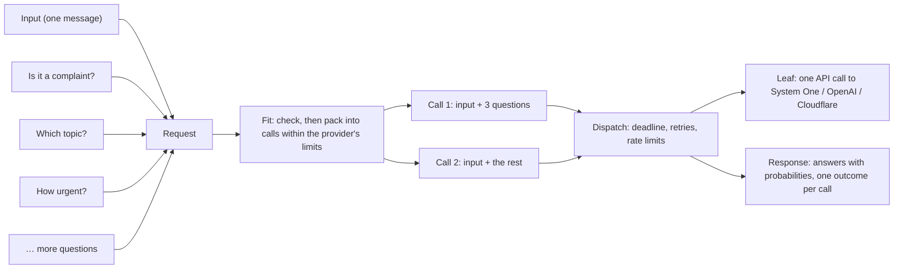

# idia

Ask a decision model many closed questions about one input, packed into calls as full as
its limits allow, and get its probabilities back, through one interface over several
providers.

When an LLM workflow has to decide something (is this message a complaint, which team gets
it, how urgent is it, which city does it name), one open prompt gives you text to parse and
no measure of how sure the model was. A closed question has a fixed answer shape (yes or
no, a label, a level on a scale, a value found in the input, a region of an image), and a
decision model answers it with probabilities (the probability of yes, or one for each label
or level), so your code can set a threshold on them and keep what was asked and answered.


A workflow asks many such questions about the same input. Asked one per call, each question
sends the whole input again; idia packs them, in order, into calls as full as the provider's
limits allow, so the input is sent once per call rather than once per question: fewer calls,
less input sent, fewer round trips. (A provider that takes one question per call, such as
`openai-chat`, gains nothing.) Providers also differ in their APIs, their limits on what one
call may hold and their errors. idia talks to any of them through one interface: it checks,
before any call, that the request fits the provider, retries under one deadline, and says
which leaf and model took each call. idia puts the questions to the models;
[ommat](https://github.com/CRSiegfried/ommat) decides.



A request that fits whole goes in one call; when it overflows a limit, each call repeats the
input, and the calls run in turn.

## Try it without keys

```text
                                            _____
                                           /     \
                                          / .   . \
                                          \       /
                                           \_____/
```

<!-- demo -->
<!-- fmt:off -->
<details>
<summary>The scripted leaf's declared capabilities</summary>

Every provider declares what it takes in a `Capabilities` record: its question kinds, its
limits, whether it claims its probabilities calibrated. A wire provider ships its own; the
scripted leaf below has no wire API behind it, so the caller declares its record, written
out in full here:

```python
from idia import UNBOUNDED, Capabilities, Rounding

RECORD = Capabilities(
    kinds=frozenset({"noul", "choice"}), modalities=frozenset({"text"}),
    image_carriers=frozenset(), max_input_tokens=8192, max_question_tokens=UNBOUNDED,
    max_body_bytes=UNBOUNDED, max_questions=UNBOUNDED, max_images=0, max_images_per_question=0,
    max_image_bytes=UNBOUNDED, max_total_image_bytes=UNBOUNDED, max_labels=20,
    max_levels=UNBOUNDED, max_total_options=UNBOUNDED, min_levels=None, min_image_side=None,
    image_media_types=None, key_patterns=(), recounts_state_per_question=False,
    returns_refusal=False, calibrated=True, snapshot_pinnable=True,
    carries_noul_descriptions=True, carries_structured_instructions=True,
    truncates_silently=False,
    confidence={}, rounding=Rounding(probability_decimals=2, score_decimals=None),
    opt_in_features=frozenset(), enabled_features=frozenset(), feature_kinds={},
    feature_modalities={},
)
```

</details>

A yes/no question and a choice about one message, in one request, put to a scripted leaf
that answers from a script with no keys; `RECORD` is its capabilities record, folded above:

```python
import asyncio

from idia import (
    Deadline, Dispatcher, Label, LabelAnswer, NoulAnswer, Question, Request, State, TextPart,
)
from idia.providers.scripted import Scripted

leaf = Scripted(capabilities=RECORD, script=[{
    "complaint": NoulAnswer(probability=0.93),
    "topic": LabelAnswer(probabilities=(("billing", 0.81), ("shipping", 0.07), ("other", 0.12))),
}])

request = Request(
    state=State(parts=(TextPart(text="The invoice is overdue and I want a refund."),)),
    questions=(
        Question(key="complaint", kind="noul", instruction="Is this a complaint?"),
        Question(key="topic", kind="choice", instruction="What is it about?",
                 labels=(Label(name="billing"), Label(name="shipping"), Label(name="other"))),
    ),
    deadline=Deadline.after(30),
)


async def main() -> None:
    async with Dispatcher(leaf) as provider:
        response = await provider.answer(request)
    print("complaint", response.answers["complaint"].probability)
    print("topic", dict(response.answers["topic"].probabilities))
    for outcome in response.outcomes:
        print(outcome.provider, outcome.model_reported, outcome.attempts,
              outcome.keys, outcome.calibrated)


asyncio.run(main())
```

Both questions went in one call, so there is one outcome. It prints the answers, then that
outcome: the leaf that took the call, the model it reported, the attempts it took (retries
included), the questions it held and whether the leaf claims its probabilities calibrated:

```text
complaint 0.93
topic {'billing': 0.81, 'shipping': 0.07, 'other': 0.12}
scripted scripted-1 1 ('complaint', 'topic') True
```
<!-- fmt:on -->
<!-- /demo -->

To ask a real model, `import idia` and use `idia.provider("cloudflare-clef")` in place of
`Dispatcher(leaf)`, with its credentials exported (below). The request is unchanged, and so
is the response's shape. Any provider below whose kinds include `noul` and `choice` takes it
too; `openai-chat` also needs `model=`.

## Install

idia is not on PyPI yet, so install it from GitHub with the extra for the provider you
call; it moves to PyPI later, and the extras keep their names. The core installs with no
dependency:

```sh
pip install "idia[system-one] @ git+https://github.com/CRSiegfried/idia@v0.1.0"
pip install "idia[openai] @ git+https://github.com/CRSiegfried/idia@v0.1.0"
pip install "idia[cloudflare] @ git+https://github.com/CRSiegfried/idia@v0.1.0"
```

System One is TypeSafe's decision-model API, whose models are named `jev-*`. Each provider
reads its credentials from the environment unless you pass them: System One reads
`TYPESAFE_API_KEY`, OpenAI reads `OPENAI_API_KEY`, and Cloudflare reads
`CLOUDFLARE_ACCOUNT_ID` and `CLOUDFLARE_API_TOKEN`. idia reads no `.env` file, so
export them first.

## Kinds and providers

A question asks for one of five kinds of answer:

| Kind | Answer | What it asks |
|---|---|---|
| `noul` | `NoulAnswer` | Yes or no, answered with one probability, that of yes; it may describe what counts as yes and as no |
| `choice` | `LabelAnswer` | One label of a set: a probability for each label |
| `score` | `LabelAnswer` | A level on an ordered scale: a probability for each level, with the expected level where the provider gives it |
| `extraction` | `ExtractionAnswer` | A value, or a list of values, of a declared type found in the input, or none, with its span (one per item) where the provider gives it |
| `box` | `BoxAnswer` | A region of an image, as fractions of its sides |

Any question may instead come back as a `Refusal`, where the provider declined it, or a
`Fault`, where its answer was missing, could not be read, or broke a rule; or with no answer,
when the wire request carrying it failed, its outcome saying why. A fault is scoped to its
question, and its siblings stand. A request idia cannot split to fit (a kind the provider
lacks, too many labels on one question, an input too long for one call, a wording form its
record does not carry) raises `DoesNotFit` before any call; it is never truncated. When no
wire request answers, `answer` raises `RequestFailed`, which carries the response and its
outcomes.

Each provider is registered under a name that `idia.provider(name)` builds, from the
extra that installs it; `idia.provider_names()` lists the names:

| Name | Extra | Kinds | Claims calibrated |
|---|---|---|---|
| `system-one` | `system-one` | `noul`, `choice`, `score`; with `images=True`, `box` too on `jev-1.14.0` and `jev-preview` | yes |
| `openai-decisions` | `openai` | `noul`, `choice`, `score` | no |
| `openai-chat` | `openai` | `noul`, `choice`, `score` | no |
| `cloudflare-clef` | `cloudflare` | `noul`, `choice`, `score` | no |
| `cloudflare-clairic` | `cloudflare` | `extraction` | no |

`openai-chat` needs `model=`, a chat model that returns logprobs, and `cloudflare-clef` also
takes `model="clef-flash"`. `cloudflare()`, in `idia.cloudflare`, is a router over Clef and
Clairic. What each provider takes, its limits and its models are in
[the providers spec](docs/spec/providers.md).

## Where next


- [Ask a provider](docs/tutorials/ask-a-provider.md): the tutorial, with live calls to
  Clef and Clairic, the `cloudflare()` router, and handling `RequestFailed`.
- [The spec](docs/spec/README.md): the normative description of every type and behaviour.
- [The changelog](CHANGELOG.md): what each release added and changed.
- Deciding with ommat: ommat binds an idia provider as an oracle through its own
  `ommat[idia]` extra, taking one leaf's dispatcher per oracle. See ommat's tutorial,
  [Decide with idia](https://github.com/CRSiegfried/ommat/blob/main/docs/tutorials/decide-with-idia.md).

## Using with an AI coding agent

[`skills/idia/SKILL.md`](skills/idia/SKILL.md) is an agent skill: it tells an AI coding
agent, such as Claude Code, when to reach for idia, the core pattern and the pitfalls, and
links into these docs for the rest. From a clone, copy it into your skills folder, or into a
project's `.claude/skills/`:

```sh
cp -r skills/idia ~/.claude/skills/
```

**The name.** Idia and Ommat come from *ommatidia*, the thousands of small hexagonal eyes
that make up a compound eye and combine into one picture: *ommat-* is the Greek stem for
"eye", *-idia* "little ones". Many small, cheap questions add up to one full picture.
Idia puts them to the models; Ommat is the engine that asks them.

## Status

idia 0.1.0 is the first release. Before 1.0 a minor release may break the API, each break
listed in the [changelog](CHANGELOG.md). A public name, one in `idia.__all__` or in the
`__all__` of a module [CONTRIBUTING.md](CONTRIBUTING.md#ground-rules-for-changes) lists, is
removed or changed only after one minor release in which it raises a `DeprecationWarning`.

## Development

```sh
uv sync --all-extras
```

Then run the checks in [CONTRIBUTING.md](CONTRIBUTING.md#development), which also gives the
ground rules; [docs/spec](docs/spec/README.md) is the normative description.

## License

MIT; see [LICENSE](LICENSE).

```text
                 ______            _____            ______
                /      \          /     \          /      \
               /  .  .  \        / .   . \        /  . .   \
               \        /        \       /        \        /
                \______/          \_____/          \______/


                               ______              ______
                              /      \            /      \
                             / .    . \          /  .  .  \
                             \        /          \        /
                              \______/            \______/
```
